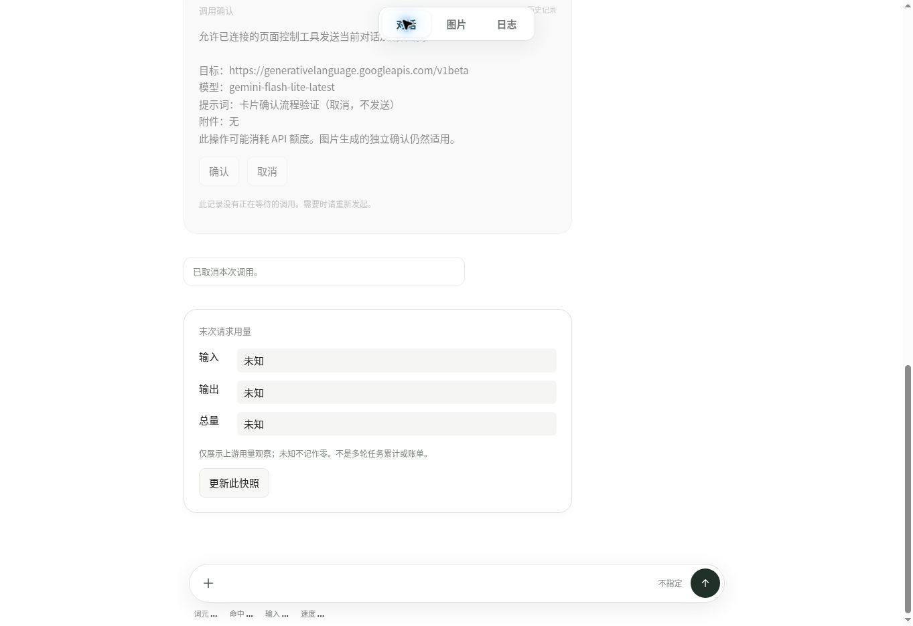

# 极简 LLM

自带 API Key 的极简 AI 网页 **v0.9.0**：对话、生成图片，以及自建视频 API。沿用同一套极简导航和输入框。

**[打开在线网页](https://zjj1280637679-ship-it.github.io/simple-llm-api-web/)**

## 三步开始

1. 打开在线网页。想在本机运行：下载仓库，在仓库文件夹的命令行运行 `python3 -m http.server 8000`，浏览器打开 `http://localhost:8000`。
2. 选择「对话」或「图片」，点 **＋ → API 设置**，填写服务地址、API Key 和模型。
3. 输入内容并发送；图片调用在确认卡确认后执行。密钥仅留在本页内存，模型费用由所选供应商收取。

[使用与开发文档](docs/README.md) · [MIT](LICENSE)

## H3 队列控制台 · /api/v1/tasks

**[打开独立 H3 队列控制台](https://zjj1280637679-ship-it.github.io/simple-llm-api-web/h3-queue/)**：兼容 `/api/v1/tasks` 和 `X-API-Key`，可上传参考素材、单条/批量提交、监控进度、预览下载 MP4，以及暂停/恢复队列、置顶、取消、重试和删除任务。服务地址与密钥在网页中填写，密钥只驻留当前页面内存；本机仅存连接地址和部分任务 ID。需要后端对 GitHub Pages 来源开放 CORS。

此控制台**不替代**下方原有 `/v1/jobs`、Bearer/BF16 视频工作台，两种接口分别维护；详情见 [队列操作说明](docs/H3_QUEUE.md)。

## 自建视频 API

选择「视频」，在「视频 API」中填入笔记本给出的公网 URL 和密钥，连接后添加参考图片、视频或音频，再输入描述并生成。至少需要一张图片或一段视频；纯文本、纯音频暂不支持。

高级设置可分别选择原生 BF16 注意力后端、已预加载的加速 LoRA 和步数。Turbo 需要显式设为 5 步（4 次模型评估），任务卡区分请求配置与实际应用回执。

模型尚未就绪时可先排队。任务卡显示排队原因与实际阶段，可取消指定任务；完成后可预览和下载 MP4。刷新后保留任务 ID，重新填写密钥即可查询原任务。密钥与参考文件不存入本机历史。

视频接口采用 MiniMax-H3 ref2va 自建服务契约，并非 OpenAI 视频接口。服务需允许网页来源的 CORS。[视频使用说明](docs/VIDEO_API.md) · [v0.9.0 更新与验证](docs/releases/v0.9.0.md)
