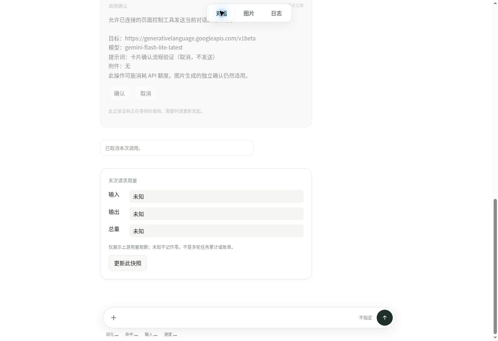

# 极简 LLM

自带 API Key 的极简 AI 网页：对话、生成图片，用对话里的交互卡调整设置。

**[打开在线网页](https://zjj1280637679-ship-it.github.io/simple-llm-api-web/)**

## 三步开始

1. 打开在线网页。想在本机运行：下载仓库，在仓库文件夹的命令行运行 `python3 -m http.server 8000`，浏览器打开 `http://localhost:8000`。
2. 选择「对话」或「图片」，点 **＋ → API 设置**，填写服务地址、API Key 和模型。
3. 输入内容并发送；图片调用在确认卡确认后执行。密钥仅留在本页内存，模型费用由所选供应商收取。

[使用与开发文档](docs/README.md) · [MIT](LICENSE)
