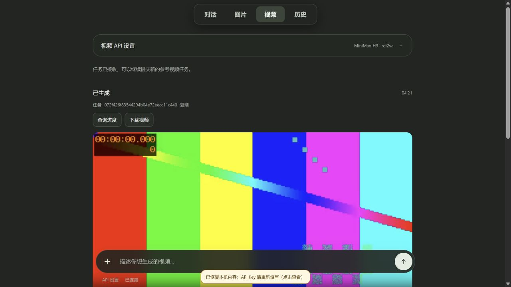

# v0.8.0 浏览器验收

2026-11-15，北京时间。本次使用本机静态网页 `127.0.0.1:8765`，跨端口连接 `127.0.0.1:8766` 的实际 FastAPI 路由与模拟管理器。测试密钥是合成值；没有真实供应商或 GPU 请求。

## 观察

| 路径 | 实际结果 |
| --- | --- |
| 连接 | Bearer 查询通过；模型未就绪时仍显示可先排队 |
| 混合参考上传 | 一次上传 PNG、WAV、MP4，按选择顺序提交 types/files，取得任务 ID |
| 多任务排队 | A / B / C 三项均取得独立任务 ID；模型未就绪时留在服务队列 |
| 取消排队 | B 从 queued 到 cancelled，其他任务保留 |
| 并行观察 | 模拟管理器同时推进 A / C，网页分别显示预处理与 GPU 阶段；这里的 GPU 阶段标签来自模拟回执，没有实际推理 |
| 运行中取消 | C 先显示 cancel_requested / 等待停止，后续查询才显示 cancelled |
| 阶段更新 | A 显示预处理、GPU、编码校验、succeeded；轮询期间输入草稿、焦点和光标位置保留 |
| 成片取回 | 点击预览后经鉴权下载、SHA-256 检查，使用 blob URL 播放；浏览器解码 512×288、5.166667 秒、readyState 4、无 media error |
| 保存文件 | 浏览器实际保存 MP4，405791 字节；与本次 FFmpeg 合成产物 SHA-256 完全一致 |
| 刷新恢复 | 三项任务 ID 保留；密钥和参考文件清空；重新连接仅查询原任务，没有自动 POST |
| 原页面回归 | 对话、图片草稿在切换视频页后保持；原交互和存档回归由完整测试集覆盖 |
| 手机布局 | 390×844 CSS 视口，body scrollWidth=clientWidth=390；导航和输入框均位于视口宽度内；正常尺寸已恢复 |

下载校验值：`3b9db693b530a5b4ecbcf1e5009625da751b5039432db68cee7f90e28bde354a`。素材是本轮新建的几何图、正弦音与 FFmpeg 测试图，没有使用模型生成内容冒充本轮实测。

## 范围

网页单测另覆盖断网、未知提交、取消和旧查询竞态、凭据更换、实例不匹配、损坏存档、并发预算和资源释放。它们是可重复的合成条件测试，不能推导云 GPU、所有浏览器、供应商可用性或完整形式证明。

配套 API 的 CORS 修复经过 584 项 CPU 测试（8 项有条件跳过）；原 notebook 的单启动单元和 console.html 保持一致。云端笔记已原位更新并下载比对，字节与本地交付一致。没有重新分配 A100。部署和最终完整回归见 [VALIDATION](../../VALIDATION.md)。

最终修复后重新加载页面，D任务再次通过提交、排队、取消，原A任务重新取回预览；浏览器无警告/错误。最终截图中的成片为合成测试图。

