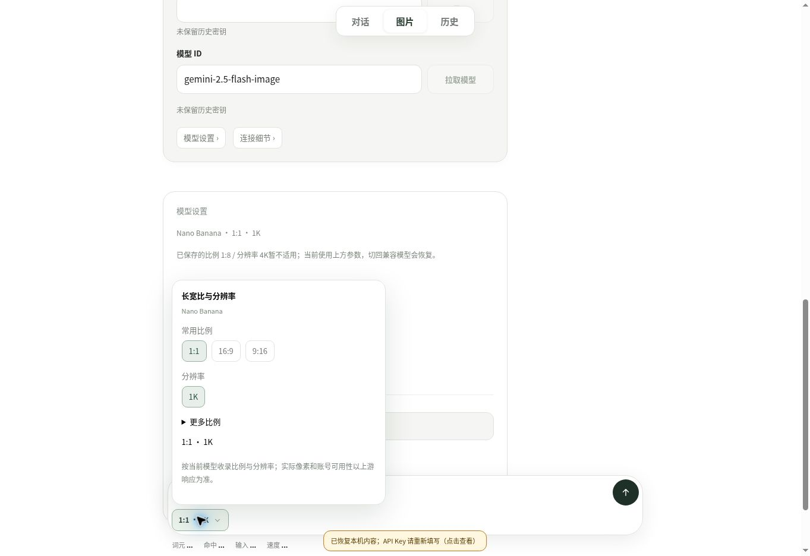
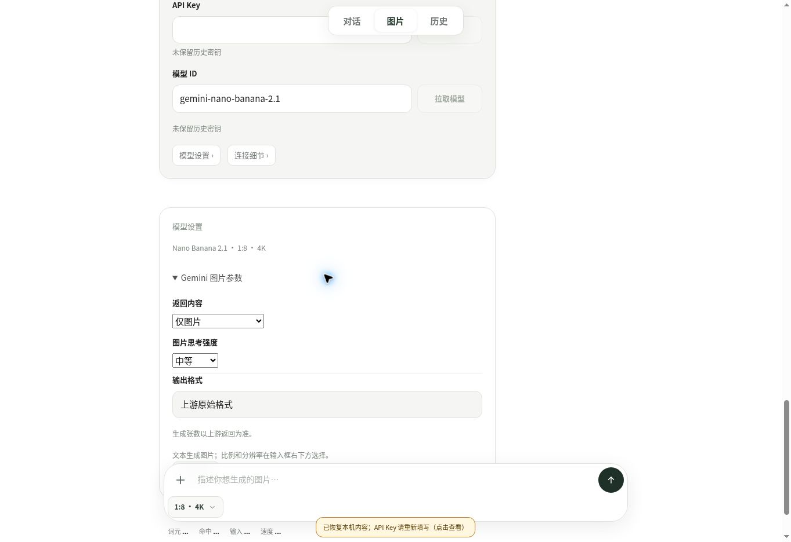

# v0.7.0 图片页线上交互观察

日期 2026-11-04；发布提交 `aee1ada500bbff7cd0dd576a8a6894013da3274e`，应用构建标识 `6b35648e7013fcd30394`。GitHub Actions [41817291282](https://github.com/zjj1280637679-ship-it/simple-llm-api-web/actions/runs/41817291282) 构建/测试成功；首次 Pages 发布 HTTP 500，仅重跑失败部署，第二次成功。

在已部署的 [工作台](https://zjj1280637679-ship-it.github.io/simple-llm-api-web/) 新建独立验收会话，通过实际按钮和选择框完成：

1. Nano Banana 2.1 选择 1:8 / 4K、仅图片、思考中等。
2. 切到 gemini-2.5-flash-image：当前回落 1:1 / 1K，菜单只显示 1K，思考选择收起，保留偏好有说明；前一模型卡仍记录原值。
3. 切到 gemini-3.1-flash-image：恢复 1:8 / 4K，菜单新增512，思考只有默认/最少/高，medium 偏好保留但不生效。
4. 切回 Nano Banana 2.1：恢复中等思考及原比例/分辨率；常规刷新后参数和既有冻结卡保留。

范围：桌面 Chrome 的上述交互与显示；未输入真实密钥、未拉取真实模型、未发生成请求；未覆盖手机/Safari。一次点击新增卡后紧接刷新时，最后新增卡未恢复；后续正常交互结束后刷新可恢复该卡，故不声称提交瞬间刷新竞态已验证。已保存参数和此前冻结历史在两次刷新中均保留。

