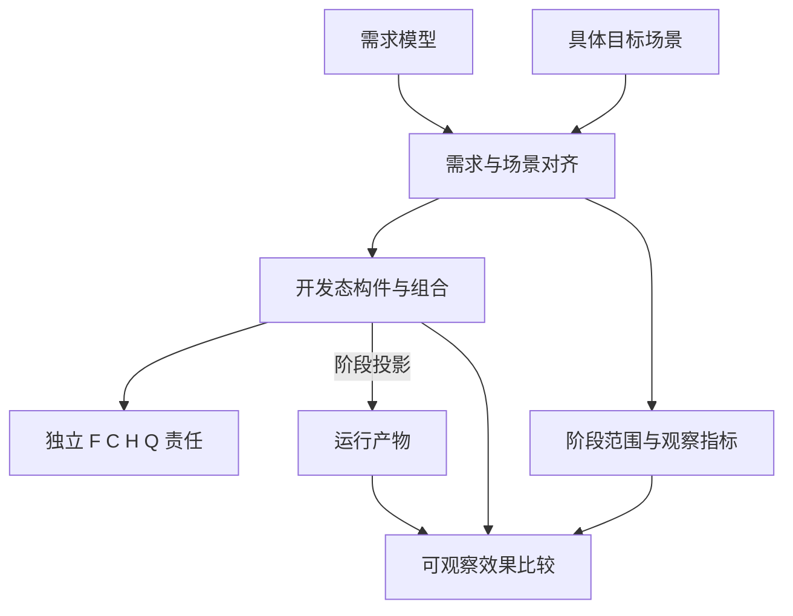
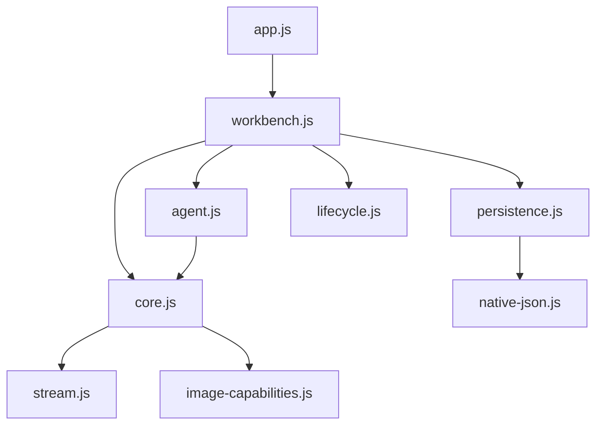
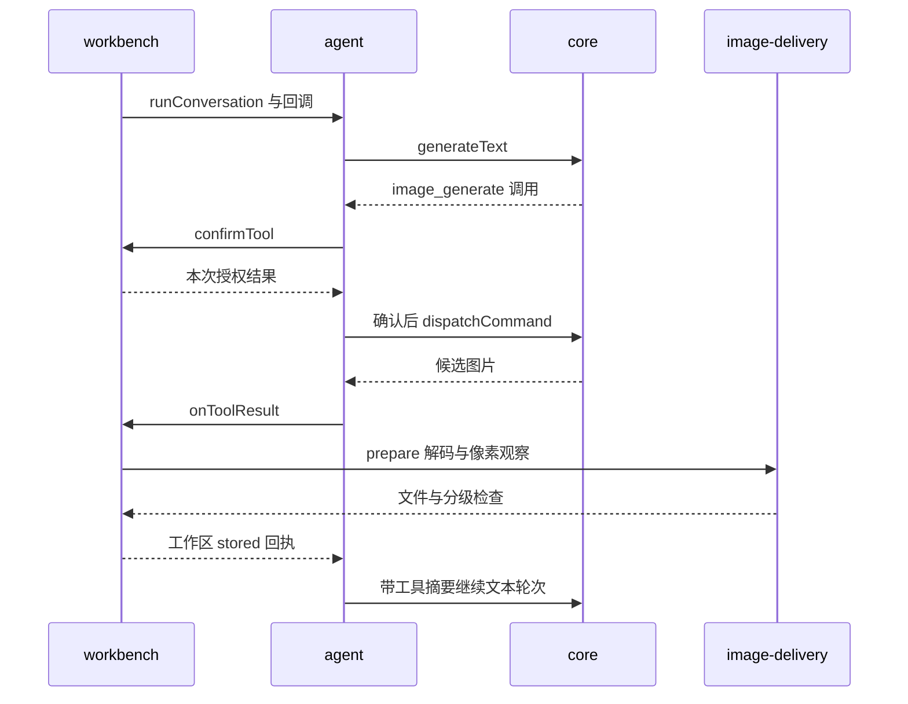

# v0.2.0 项目快照：给 agent 的深度入口

知识版本 1.0.0；2026-10-30（北京时间）。项目基线 [70290ba6f00b](https://github.com/zjj1280637679-ship-it/simple-llm-api-web/tree/70290ba6f00b9035f94ecde7ac95849b5ea190a5)，树 `644bea7f6b5161b5fa740dfa5be0176ffc56146c`。184 个源文件均已核对；知识图自身是随后附加的记录。相对链接方便浏览当前工作区，精确历史定位使用 graph.json 的 source.commit 和 refs。

## 先理解这六件事

1. **产品**：无侧栏、无起始页的 BYOK 静态工作台；对话、图片、日志三个标签。用户在浏览器中按动作请求选定服务地址。没有内置共享后端或服务端密钥。
2. **实现**：原生 JavaScript ES modules，无生产 npm 依赖。`index.html → src/app.js → createWorkbench()`；工作区组合显式提供 `ready` / `dispose`。图片 CLI 与网页共用 core；网页会话 CLI 是另一条需要浏览器宿主的路径。
3. **目标**：开发态以功能/关系/组合块积累、独立实验并验收；运行态是稳定需求/条件阶段的投影。当前代码正在向此模型演进，普通 dist 构建尚不是投影等效证明。
4. **当前模块库**：14 个登记模块各有契约和独立最简宿主，宿主 import 真实生产实现。其余既有代码尚未全部原子化；core 与 workbench 仍承载多项职责。
5. **证据**：上次完整回归 377 通过、1 跳过；14 个本地宿主通过；云端 Chrome 有有限线上验收。证据保留各自源码、环境和观察范围。本次知识整理没有新增模型真实调用。
6. **判断**：字段名不是秘密判定，模板范围不是上游能力，发送流程完成不是目标达成；UNKNOWN、未实现、不满足条件、无法达标不是同一个状态。

## 目标、场景与双轨关系

下图表示设计约束及追溯关系，不表示所有机制已实现。需求模型记录维度范围与依赖；具体场景固定环境、输入、资源、授权与供应商条件。

来源：[开发态模型](../../../design/DEVELOPMENT_MODEL.md)、[当前决策](../../../design/DECISIONS.md)。阶段边界由需求/条件方向漂移识别，不等于提交、版本号或发布日期。

| 概念 | agent 应保留的区别 |
| --- | --- |
| 吸引子 / 排斥子 | 按声明方向接近 / 远离极限趋势；不用到无穷大的普通数值距离 |
| 甜蜜点 / 苦涩点 | 接近特定状态得奖励 / 惩罚；反方向不自动构成相反价值 |
| 正区间 / 负区间 | 指定区间内奖励 / 惩罚；外部保持对应中性 |
| 正花园 / 负深渊 | 指定区间外奖励 / 惩罚；区间内保持对应中性 |
| 混合维度 | 奖励与惩罚分别保存，可能同时存在且量纲不同 |
| 做、反做、不做、改进、等效做 | 方向反转、效果缺失、局部提升、换途径达标各自判断；2−1 达成 1 还需比较条件和副作用 |
| F/C/H/Q | 形式化、客观条件、成功替代途径距离、最低效果分别验收；此快照 14 块契约均为 UNKNOWN |

图中列出任务完成、操作负担、参数表达、内容保真、凭据暴露、延迟、费用、追溯性、状态复杂度、阅读成本十个目标维度；尚未给它们补造统一权重、形状、数值阈值或评分。

## 实现骨架及入口

下图只摘录真实静态导入关系；回调注入和 DOM 事件不在这幅图中。更完整的字面引用在 JSON 图中，并带源码行锚点。

| 入口 | 实际职责 | 优先查看 |
| --- | --- | --- |
| 浏览器 | 启动、当前页面组合和完整初始化 | [app.js](../../../src/app.js)、[workbench.js](../../../src/workbench.js) |
| 协议与请求 | 地址、头、参数、流/JSON、完成字段、图片和 typed dispatcher | [core.js](../../../src/core.js)、[stream.js](../../../src/stream.js) |
| 模型工具循环 | 两轮工具上限、总调用预算、确认、去重、历史检查点、回执 | [agent.js](../../../src/agent.js) |
| 图片 Node CLI | 通过同一个 dispatcher 调用并写文件 | [cli.mjs](../../../cli.mjs) |
| 网页会话 CLI | 通过已授权宿主操作当前页面 | [web-cli.mjs](../../../web-cli.mjs)、[WEB_SESSION.md](../../../WEB_SESSION.md) |
| 开发原件 | 当时的视觉/交互设计和样例 | [design/index.html](../../../design/index.html)，不作为生产入口 |
| 发布 | 白名单 dist、内容版本引用、PR/main 检查 | [build.mjs](../../../scripts/build.mjs)、[Pages 工作流](../../../.github/workflows/pages.yml) |

生产支持范围：文本适配 Gemini 原生、OpenAI 兼容/普通 Ark、Anthropic Messages；图片预设覆盖指定 Gemini 和 Ark 模型。具体 provider/model/参数以当前代码表为准，模板收录不构成账号权限或实时可用性证明。结构化输出 PR #4 尚未启用。

## 六条关键路径

| 路径 / 查询 | 读代码时跟踪什么 | 效果边界 |
| --- | --- | --- |
| `show flow:startup` | 创建资源所有者 → 等待水合 → 开放会话 → 条件注册 WebMCP；dispose 取消所有权 | ready 前不可当成初始化完成；晚到回调与销毁关系单独测试 |
| `show flow:text` | workbench.send → agent.runConversation → core.generateText → stream → 增量绘制/历史 | completion、页面发送返回状态、内容正确性与目标完成分开 |
| `show flow:image` | 确认调用 → core 候选文件 → image-delivery 解码/尺寸 → appendImages 回执 → agent 工具摘要 | 文件签名、解码、尺寸、工作区存入、持久化提交、屏幕可见、目标满意是不同命题 |
| `show flow:storage` | 水合门 → 投影/原生保真 → journal / 完整快照分别失败 → 版本冲突与恢复 | 已登记凭据碰撞阻止新快照，不以删掉原生字段取得保存成功 |
| `show flow:session` | CLI / WebMCP → 七命令验证 → 页面确认 → 前后快照核对 → 页面 send/cancel | 页面工具观察不等于真实 Node CLI→浏览器闭环已验收 |
| `show flow:release` | 检查/宿主/回归 → 30 文件构建 → main Pages → 单独浏览器观察 | CI、部署成功、外部模型可用性及阶段等效各自留证 |

图片工具交互的关键关系如下；`onToolResult` 是网页组合提供的回调，而非 core 自己保存页面状态。

## 状态、资源和版本

workbench 拥有页面选择、两工作区数据、配置卡及待确认请求；关系块拥有具体计时器、存档协调、几何/焦点和阅读位置。[WORKBENCH_MODULES.md](../../../docs/WORKBENCH_MODULES.md) 是详细所有权表。`logs.js`、core 凭据观察者目前是页面/Node 进程共享范围，不是任意多租户隔离机制。

以下表从 catalog 及契约提取；模块与宿主各自保留版本和时间。F/C/H/Q 的 UNKNOWN 与宿主本地 PASS 同时成立，不相互替代。

| ID / 类别 | 实现 | 模块版本 | 宿主版本 | 契约 / 宿主 |
| --- | --- | --- | --- | --- |
| C-002 / composition | [workbench.js](../../../src/workbench.js) | 0.1.0 | 0.1.0 | [契约](../../../docs/contracts/workbench.json) / [宿主](../../../development/hosts/workbench.mjs) |
| F-006 / function | [native-json.js](../../../src/native-json.js) | 0.1.0 | 0.1.1 | [契约](../../../docs/contracts/native-json.json) / [宿主](../../../development/hosts/native-json.mjs) |
| F-007 / function | [image-delivery.js](../../../src/image-delivery.js) | 0.1.0 | 0.1.0 | [契约](../../../docs/contracts/image-delivery.json) / [宿主](../../../development/hosts/image-delivery.mjs) |
| F-008 / function | [error-diagnostic.js](../../../src/error-diagnostic.js) | 0.1.0 | 0.1.0 | [契约](../../../docs/contracts/error-diagnostic.json) / [宿主](../../../development/hosts/error-diagnostic.mjs) |
| F-009 / function | [view-markup.js](../../../src/view-markup.js) | 0.1.0 | 0.1.0 | [契约](../../../docs/contracts/view-markup.json) / [宿主](../../../development/hosts/view-markup.mjs) |
| R-005 / relation | [provider-identity.js](../../../src/provider-identity.js) | 0.1.0 | 0.1.1 | [契约](../../../docs/contracts/provider-identity.json) / [宿主](../../../development/hosts/provider-identity.mjs) |
| R-006 / relation | [lifecycle.js](../../../src/lifecycle.js) | 0.1.0 | 0.1.0 | [契约](../../../docs/contracts/lifecycle.json) / [宿主](../../../development/hosts/lifecycle.mjs) |
| R-007 / relation | [canvas-geometry.js](../../../src/canvas-geometry.js) | 0.1.0 | 0.1.0 | [契约](../../../docs/contracts/canvas-geometry.json) / [宿主](../../../development/hosts/canvas-geometry.mjs) |
| R-008 / relation | [view-position.js](../../../src/view-position.js) | 0.1.0 | 0.1.0 | [契约](../../../docs/contracts/view-position.json) / [宿主](../../../development/hosts/view-position.mjs) |
| R-009 / relation | [request-lifecycle.js](../../../src/request-lifecycle.js) | 0.1.0 | 0.1.0 | [契约](../../../docs/contracts/request-lifecycle.json) / [宿主](../../../development/hosts/request-lifecycle.mjs) |
| R-010 / relation | [workspace-storage.js](../../../src/workspace-storage.js) | 0.1.0 | 0.1.0 | [契约](../../../docs/contracts/workspace-storage.json) / [宿主](../../../development/hosts/workspace-storage.mjs) |
| R-011 / relation | [clipboard-report.js](../../../src/clipboard-report.js) | 0.1.0 | 0.1.0 | [契约](../../../docs/contracts/clipboard-report.json) / [宿主](../../../development/hosts/clipboard-report.mjs) |
| R-012 / relation | [stream-painter.js](../../../src/stream-painter.js) | 0.1.0 | 0.1.0 | [契约](../../../docs/contracts/stream-painter.json) / [宿主](../../../development/hosts/stream-painter.mjs) |
| R-013 / relation | [transport-evidence.js](../../../src/transport-evidence.js) | 0.1.0 | 0.1.0 | [契约](../../../docs/contracts/transport-evidence.json) / [宿主](../../../development/hosts/transport-evidence.mjs) |

## 知识库按问题阅读

下列分类链接到具体主题；研究文档中的日期、模型规则和旧 UI 观察保留历史条件。`node knowledge/query.mjs route <ID>` 同时给出源码与相关测试，避免只读文案。

| 路由 | 文档入口 |
| --- | --- |
| `model` 目标与评价模型 | [DEVELOPMENT_MODEL.md](../../../design/DEVELOPMENT_MODEL.md)、[DECISIONS.md](../../../design/DECISIONS.md)、[REQUIREMENTS.md](../../../design/REQUIREMENTS.md) |
| `ownership` 模块和状态归属 | [WORKBENCH_MODULES.md](../../../docs/WORKBENCH_MODULES.md)、[README.md](../../../module-library/README.md)、[catalog.json](../../../module-library/catalog.json)、[README.md](../../../docs/contracts/README.md) |
| `transport` 地址、协议与凭据 | [provider-formats.md](../../../docs/provider-formats.md)、[provider-presets.md](../../../docs/provider-presets.md)、[api-auto-apply.md](../../../docs/api-auto-apply.md)、[credentials.md](../../../docs/credentials.md)、[ark-api.md](../../../docs/ark-api.md)、[anthropic-messages.md](../../../docs/anthropic-messages.md) |
| `conversation` 文本、流与工具循环 | [STREAMING.md](../../../docs/STREAMING.md)、[WEB_SESSION.md](../../../WEB_SESSION.md) |
| `reasoning` 思考模板与来源 | [REASONING_TEMPLATES.md](../../../docs/REASONING_TEMPLATES.md)、[PROVIDER_REASONING.md](../../../docs/PROVIDER_REASONING.md)、[REASONING_MODEL_EVIDENCE.md](../../../docs/REASONING_MODEL_EVIDENCE.md)、[source-claims.json](../../../docs/evidence/source-claims.json) |
| `image` 图片输入参数与交付 | [ark-api.md](../../../docs/ark-api.md)、[attachments.md](../../../docs/attachments.md)、[WORKBENCH_MODULES.md](../../../docs/WORKBENCH_MODULES.md) |
| `storage` 保存、保真与恢复 | [LOCAL_PERSISTENCE.md](../../../docs/LOCAL_PERSISTENCE.md)、[native-json.json](../../../docs/contracts/native-json.json) |
| `attachments` 附件与模态 | [attachments.md](../../../docs/attachments.md) |
| `metrics` 用量与结果语义 | [USAGE_METRICS.md](../../../docs/USAGE_METRICS.md)、[DEEPSEEK_CACHE.md](../../../docs/DEEPSEEK_CACHE.md)、[GEMINI_CACHE_ZERO.md](../../../docs/GEMINI_CACHE_ZERO.md)、[loading-status.md](../../../docs/loading-status.md) |
| `layout` 布局、焦点、滚动和诊断 | [floating-navigation.md](../../../docs/floating-navigation.md)、[floating-composer.md](../../../docs/floating-composer.md)、[floating-menus.md](../../../docs/floating-menus.md)、[responsive-reflow.md](../../../docs/responsive-reflow.md)、[settings-text-wrap.md](../../../docs/settings-text-wrap.md)、[mobile-view-state.md](../../../docs/mobile-view-state.md)、[mobile-send-scroll.md](../../../docs/mobile-send-scroll.md)、[mobile-focus-intent.md](../../../docs/mobile-focus-intent.md)、[scroll-diagnostics.md](../../../docs/scroll-diagnostics.md)、[safari-gray-canvas.md](../../../docs/safari-gray-canvas.md) |
| `catalog` 供应商资料与历史选型 | [ark-model-catalog.md](../../../docs/ark-model-catalog.md)、[ark-model-catalog.json](../../../docs/ark-model-catalog.json)、[source-claims.json](../../../docs/evidence/source-claims.json) |
| `validation` 验证、审查与发布 | [VALIDATION.md](../../../VALIDATION.md)、[2026-10-30.md](../../../docs/reviews/2026-10-30.md)、[2026-10-30-update.md](../../../docs/reviews/2026-10-30-update.md)、[2026-10-30-browser.md](../../../docs/reviews/2026-10-30-browser.md)、[2026-10-29-initial-validation.md](../../../docs/evidence/2026-10-29-initial-validation.md) |

## 证据、差异和下一步

| 结论 | 对应证据 / 保留边界 |
| --- | --- |
| 377 通过、1 跳过、14 个宿主通过 | [review.json](../../../development/evidence/review.json) 记录于 2026-10-29T20:21:15.940Z；带 128 个输入指纹和原始输出，跳过项为可选 MCP SDK 合成 peer |
| 线上有限 UI 观察 | [浏览器记录](../../../docs/reviews/2026-10-30-browser.md)，代码提交 fb155f9、构建 e49191b5756d2d581237；云端 Chrome 1363×936、合成记录、无模型调用 |
| 历史 Ark 图片成功 | [初始观察](../../../docs/evidence/2026-10-29-initial-validation.md)，仅覆盖当时账号和调用条件 |
| 旧 PR #1/#2/#4 | [catalog 候选身份](../../../module-library/catalog.json)，保留精确提交；不自动贡献当前能力与证据 |
| 外部资料 | [source-claims](../../../docs/evidence/source-claims.json)、[模型目录](../../../docs/ark-model-catalog.json)；缺原始快照/实测的部分仍待补，复核日期不是可用性认证 |

特别注意两个容易误读的位置：

- `docs/contracts/README.md` 前半保留早期“目录待接入、两宿主 0.1.0”的表述；本基线 catalog 已含 14 块，F-006/R-005 对应宿主已是 **0.1.1**。图谱精确引用卡片，并将这项文字差异登记为 `boundary:contract-prose`，没有静默改写历史文件。
- `workbench.send()` 的 `status: completed` 是页面发送处理流程返回；`runConversation` 的 completion 可能为 unknown。`appendImages` 的 stored 表示存入工作区，不等于 IndexedDB 已完成事务。需要更严格目标的消费者须定义自己的效果判据。

后续适合按最小阻塞分别推进：具体化仍为 declared-effect 的目标谓词与状态预算；继续拆分供应商编码/结束语义/能力证据；建立达标替代途径池；选定稳定阶段及观察容差；补充真实模型、移动端和 CLI 闭环验证。每项是单独的实验与证明责任，不由图谱中的一条箭头宣称已经解决。

更改前先运行 `node knowledge/check.mjs`；出现 DRIFT 时，使用变化列表和 `impact` 查询定位需重读范围。更新方法见 [知识图维护](../../README.md#更新快照)。
