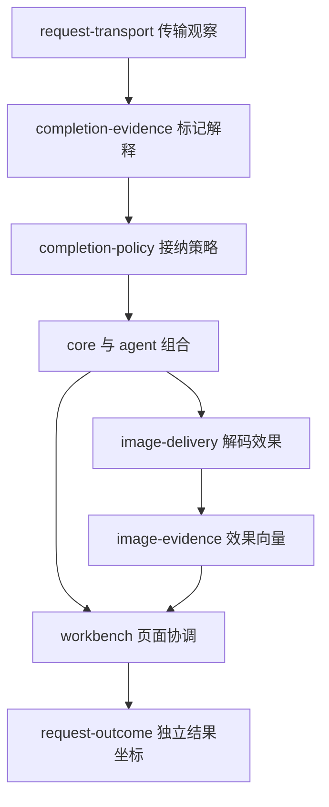

# v0.3.0 开发态知识快照

知识版本 **1.1.0**；2026-10-30（北京时间）。项目源提交 `d0b794896092c2b68fb40e0be33697a7d8a528e4`，树 `341216ea229a5a8326be3bd6444b8ca6c2e53681`。知识发布是其后的独立提交。当前图覆盖 213 个项目文件（不含 AGENTS.md 和 knowledge 发布附加项）、21 个模块与宿主，共 329 节点、822 条关系。

## 从这个版本开始应如何理解项目

项目仍是原生 ES modules 的静态 BYOK 工作台：对话、图片、日志，独立图片 CLI 与网页会话 CLI；没有内置共享密钥后端。v0.3.0 的变化在开发态判断结构，网页主要交互保持既有路径。

把同一次任务的五层分别阅读：输入/观察、局部解释、场景策略、执行效果、目标验收。某层有结果，不自动使其他层为真。新增纯函数没有 DOM、网络或存储依赖；效果模块在声明宿主边界上执行；core/agent/workbench 继续管理组合。

这是判断责任的关系图，具体函数调用还经过 core/stream/workbench 的适配。JSON 图中的 references_import 才表示字面静态导入；回调和事件没有被当作完整自动推导的依赖图。

## 理想、实现与证据分开

[开发态模型](../../../design/DEVELOPMENT_MODEL.md)保留需求模型—目标场景、八类评价形状、独立奖励/惩罚与对应中性、做/反做/不做/改进/等效做。维度函数、阈值和权重没有被知识图擅自填成固定数值。

[认识论设计](../../../design/EPISTEMIC_DESIGN.md)把课题拆分落实在代码；[决策记录](../../../design/DECISIONS.md)解释当前场景的限制与替代方向。开发态与运行态仍是两轨：当前 37 文件 dist 和哈希版本提供追溯，不是阶段投影等效证明。阶段取决于需求/条件方向稳定，不等同 Git 提交。

| 层 | 当前状态 |
| --- | --- |
| 独立判断课题 | 结束解释与接纳、图片效果与目标、返回状态与实际完成分离 |
| 契约 | 21 块均有具体问题、效果目标、状态范围、反例、扩展点与证明义务 |
| 本地宿主 | 21 个独立运行通过，真实 import，外部条件按宿主声明 |
| 有限模型 | 680 个结束条件组合、820 个图片列表组合及伪造回执检查通过 |
| 全实现形式证明 | UNKNOWN；有限类与全部输入的对应、引擎/DOM/网络等信任基仍有义务 |
| 替代路线与投影 | 完整 H 池和阶段等效验收尚未完成 |

## 新判断边界

| 文件 | 回答的问题 | 扩展方向 |
| --- | --- | --- |
| api-target | 当前公共网页接受何种目标及凭据绑定？ | 新宿主可另定义目标策略，不把现有范围当永久禁令 |
| request-transport | HTTP/流、取消和有限诊断实际发生什么？ | 显式 transport 注入、来源声明、预算和释放关系 |
| completion-evidence | 结束标记是已知完整、明确未完整、拒绝还是未知？ | 精确扩展本地 profile 与反例 |
| completion-policy | 当前 JSON/SSE 入口是否接纳这份证据？ | 单独修改条件/收益/代价，不篡改证据含义 |
| image-evidence | 文件、解码、像素、工作区存入支持哪些结论？ | 每个新效果添加自己的观察者和判据 |
| request-outcome | 发送返回为消费者建立了哪个命题？ | 独立结果字段，不用一个 ok/completed 代表所有效果 |
| app-error | 怎样保留本地诊断身份？ | code 说明边界，不凭 HTTP 状态编造唯一根因 |

## 关键流程

| 流程节点 | 当前步骤 | 限制 |
| --- | --- | --- |
| `flow:startup` 启动、恢复与释放 | 创建工作区组合及资源所有者；等待持久化水合，完成后开放页面会话；条件支持时注册 WebMCP 并渲染；dispose 使会话失活、终止/释放所属资源 | 异步销毁/晚到回调由各所有者处理；不是任意多实例隔离保证。 |
| `flow:text` 文本流与可选图片工具 | 读取当前配置、附件、工作区，构建本次调用快照；agent 请求文本；core 选择协议/传输，stream 解析；结束标记由 completion-evidence 解释，再由 completion-policy 决定当前入口接纳；正文/公开思考增量进入当前视图，结束信息与原生上下文返回；可选 image_generate 经验证与确认后调用 dispatcher；检查点保留已完成操作 | completion、发送控制流状态、内容语法、用户目标分别判断；无自动网络重试。 |
| `flow:image` 图片候选到工作区 | 按明确 provider/model 预设归一化参数并确认本次调用；core 返回候选文件和签名信息；image-delivery 解码并观察像素；偏差仍可保留下载；appendImages 写入工作区并回传 stored；agent 更新工具摘要 | stored/delivered=workspace 不等于 IndexedDB 事务已提交、屏幕可见或目标满意。 |
| `flow:storage` 保存与刷新恢复 | 水合完成前不开放写入；显式投影配置；保真复制 native raw，已登记凭据碰撞使新快照失败；即时 journal 和完整快照分别处理错误；存档版本冲突/超限保留旧成功记录并报告状态 | schema=1；普通 apiKey 业务键不是自动删键理由；备份仍可能含私人内容。 |
| `flow:session` 外部工具控制当前页面 | CLI 通过显式配置/授权的浏览器宿主定位目标页面；WebMCP 工具进入七个会话命令的验证与 handler；发送取得页面确认并核对前后配置快照；共用页面 send/cancel，不能把 transport 声明当用户同意；发送结果的 outcome 分别表达流程、协议、交付与未知目标 | 页面工具有限观察不等于 Node CLI→真实浏览器完整闭环已验收。 |
| `flow:release` 检查、构建与发布 | PR 执行检查、宿主、回归与白名单构建；main 同样验证后由 Pages 发布 dist；内容哈希版本绑定当前生产输入和相对引用；发布结果与真实浏览器观察另行留证 | 普通构建没有实现完整阶段投影等效证明；knowledge/ 不在生产白名单。 |

页面继续返回兼容 `status: completed`，并提供 `outcome`：operation、protocolCompletion、workspaceDelivery、durablePersistence、visibleToUser、goalSatisfied。未知结束不会因为正常返回而升级；工作区 stored 不意味着 IndexedDB 已提交。`runConversation` 的 completion 是另一份协议证据，仍不等于用户目标。

## 模块与宿主

版本精确绑定；宿主时间和模块时间分别见契约。完整 F/C/H/Q 均保持 UNKNOWN，下面的 local PASS 只覆盖声明观察。

| ID / 类别 | 实现 | 模块版本 | 宿主版本 | 契约 / 宿主 |
| --- | --- | --- | --- | --- |
| C-002 / composition | [workbench.js](../../../src/workbench.js) | 0.2.0 | 0.1.1 | [契约](../../../docs/contracts/workbench.json) / [宿主](../../../development/hosts/workbench.mjs) |
| F-006 / function | [native-json.js](../../../src/native-json.js) | 0.1.1 | 0.1.2 | [契约](../../../docs/contracts/native-json.json) / [宿主](../../../development/hosts/native-json.mjs) |
| F-007 / function | [image-delivery.js](../../../src/image-delivery.js) | 0.1.1 | 0.1.1 | [契约](../../../docs/contracts/image-delivery.json) / [宿主](../../../development/hosts/image-delivery.mjs) |
| F-008 / function | [error-diagnostic.js](../../../src/error-diagnostic.js) | 0.1.1 | 0.1.1 | [契约](../../../docs/contracts/error-diagnostic.json) / [宿主](../../../development/hosts/error-diagnostic.mjs) |
| F-009 / function | [view-markup.js](../../../src/view-markup.js) | 0.1.1 | 0.1.1 | [契约](../../../docs/contracts/view-markup.json) / [宿主](../../../development/hosts/view-markup.mjs) |
| F-010 / function | [completion-evidence.js](../../../src/completion-evidence.js) | 0.1.0 | 0.1.0 | [契约](../../../docs/contracts/completion-evidence.json) / [宿主](../../../development/hosts/completion-evidence.mjs) |
| F-011 / function | [image-evidence.js](../../../src/image-evidence.js) | 0.1.0 | 0.1.0 | [契约](../../../docs/contracts/image-evidence.json) / [宿主](../../../development/hosts/image-evidence.mjs) |
| F-012 / function | [request-outcome.js](../../../src/request-outcome.js) | 0.1.0 | 0.1.0 | [契约](../../../docs/contracts/request-outcome.json) / [宿主](../../../development/hosts/request-outcome.mjs) |
| F-013 / function | [api-target.js](../../../src/api-target.js) | 0.1.0 | 0.1.0 | [契约](../../../docs/contracts/api-target.json) / [宿主](../../../development/hosts/api-target.mjs) |
| F-014 / function | [app-error.js](../../../src/app-error.js) | 0.1.0 | 0.1.0 | [契约](../../../docs/contracts/app-error.json) / [宿主](../../../development/hosts/app-error.mjs) |
| R-005 / relation | [provider-identity.js](../../../src/provider-identity.js) | 0.1.1 | 0.1.2 | [契约](../../../docs/contracts/provider-identity.json) / [宿主](../../../development/hosts/provider-identity.mjs) |
| R-006 / relation | [lifecycle.js](../../../src/lifecycle.js) | 0.1.1 | 0.1.1 | [契约](../../../docs/contracts/lifecycle.json) / [宿主](../../../development/hosts/lifecycle.mjs) |
| R-007 / relation | [canvas-geometry.js](../../../src/canvas-geometry.js) | 0.1.1 | 0.1.1 | [契约](../../../docs/contracts/canvas-geometry.json) / [宿主](../../../development/hosts/canvas-geometry.mjs) |
| R-008 / relation | [view-position.js](../../../src/view-position.js) | 0.1.1 | 0.1.1 | [契约](../../../docs/contracts/view-position.json) / [宿主](../../../development/hosts/view-position.mjs) |
| R-009 / relation | [request-lifecycle.js](../../../src/request-lifecycle.js) | 0.1.1 | 0.1.1 | [契约](../../../docs/contracts/request-lifecycle.json) / [宿主](../../../development/hosts/request-lifecycle.mjs) |
| R-010 / relation | [workspace-storage.js](../../../src/workspace-storage.js) | 0.1.1 | 0.1.1 | [契约](../../../docs/contracts/workspace-storage.json) / [宿主](../../../development/hosts/workspace-storage.mjs) |
| R-011 / relation | [clipboard-report.js](../../../src/clipboard-report.js) | 0.1.1 | 0.1.1 | [契约](../../../docs/contracts/clipboard-report.json) / [宿主](../../../development/hosts/clipboard-report.mjs) |
| R-012 / relation | [stream-painter.js](../../../src/stream-painter.js) | 0.1.1 | 0.1.1 | [契约](../../../docs/contracts/stream-painter.json) / [宿主](../../../development/hosts/stream-painter.mjs) |
| R-013 / relation | [transport-evidence.js](../../../src/transport-evidence.js) | 0.1.1 | 0.1.1 | [契约](../../../docs/contracts/transport-evidence.json) / [宿主](../../../development/hosts/transport-evidence.mjs) |
| R-014 / relation | [completion-policy.js](../../../src/completion-policy.js) | 0.1.0 | 0.1.0 | [契约](../../../docs/contracts/completion-policy.json) / [宿主](../../../development/hosts/completion-policy.mjs) |
| R-015 / relation | [request-transport.js](../../../src/request-transport.js) | 0.1.0 | 0.1.0 | [契约](../../../docs/contracts/request-transport.json) / [宿主](../../../development/hosts/request-transport.mjs) |

## 按课题进入知识库

用 `node knowledge/query.mjs route judgments` 查看新增认识论路线；`show R-014` 可读取问题、状态边界、证明义务及全部相邻关系。

| 路由 | 文档入口 |
| --- | --- |
| `model` 目标与评价模型 | [DEVELOPMENT_MODEL.md](../../../design/DEVELOPMENT_MODEL.md)、[DECISIONS.md](../../../design/DECISIONS.md)、[REQUIREMENTS.md](../../../design/REQUIREMENTS.md) |
| `ownership` 模块和状态归属 | [WORKBENCH_MODULES.md](../../../docs/WORKBENCH_MODULES.md)、[README.md](../../../module-library/README.md)、[catalog.json](../../../module-library/catalog.json)、[README.md](../../../docs/contracts/README.md) |
| `transport` 地址、协议与凭据 | [provider-formats.md](../../../docs/provider-formats.md)、[provider-presets.md](../../../docs/provider-presets.md)、[api-auto-apply.md](../../../docs/api-auto-apply.md)、[credentials.md](../../../docs/credentials.md)、[ark-api.md](../../../docs/ark-api.md)、[anthropic-messages.md](../../../docs/anthropic-messages.md) |
| `conversation` 文本、流与工具循环 | [STREAMING.md](../../../docs/STREAMING.md)、[WEB_SESSION.md](../../../WEB_SESSION.md) |
| `reasoning` 思考模板与来源 | [REASONING_TEMPLATES.md](../../../docs/REASONING_TEMPLATES.md)、[PROVIDER_REASONING.md](../../../docs/PROVIDER_REASONING.md)、[REASONING_MODEL_EVIDENCE.md](../../../docs/REASONING_MODEL_EVIDENCE.md)、[source-claims.json](../../../docs/evidence/source-claims.json) |
| `image` 图片输入参数与交付 | [ark-api.md](../../../docs/ark-api.md)、[attachments.md](../../../docs/attachments.md)、[WORKBENCH_MODULES.md](../../../docs/WORKBENCH_MODULES.md) |
| `storage` 保存、保真与恢复 | [LOCAL_PERSISTENCE.md](../../../docs/LOCAL_PERSISTENCE.md)、[native-json.json](../../../docs/contracts/native-json.json) |
| `attachments` 附件与模态 | [attachments.md](../../../docs/attachments.md) |
| `metrics` 用量与结果语义 | [USAGE_METRICS.md](../../../docs/USAGE_METRICS.md)、[DEEPSEEK_CACHE.md](../../../docs/DEEPSEEK_CACHE.md)、[GEMINI_CACHE_ZERO.md](../../../docs/GEMINI_CACHE_ZERO.md)、[loading-status.md](../../../docs/loading-status.md) |
| `layout` 布局、焦点、滚动和诊断 | [floating-navigation.md](../../../docs/floating-navigation.md)、[floating-composer.md](../../../docs/floating-composer.md)、[floating-menus.md](../../../docs/floating-menus.md)、[responsive-reflow.md](../../../docs/responsive-reflow.md)、[settings-text-wrap.md](../../../docs/settings-text-wrap.md)、[mobile-view-state.md](../../../docs/mobile-view-state.md)、[mobile-send-scroll.md](../../../docs/mobile-send-scroll.md)、[mobile-focus-intent.md](../../../docs/mobile-focus-intent.md)、[scroll-diagnostics.md](../../../docs/scroll-diagnostics.md)、[safari-gray-canvas.md](../../../docs/safari-gray-canvas.md) |
| `catalog` 供应商资料与历史选型 | [ark-model-catalog.md](../../../docs/ark-model-catalog.md)、[ark-model-catalog.json](../../../docs/ark-model-catalog.json)、[source-claims.json](../../../docs/evidence/source-claims.json) |
| `validation` 验证、审查与发布 | [VALIDATION.md](../../../VALIDATION.md)、[2026-10-30.md](../../../docs/reviews/2026-10-30.md)、[2026-10-30-update.md](../../../docs/reviews/2026-10-30-update.md)、[2026-10-30-browser.md](../../../docs/reviews/2026-10-30-browser.md)、[2026-10-29-initial-validation.md](../../../docs/evidence/2026-10-29-initial-validation.md) |
| `judgments` 认识论判断链与有限模型 | [EPISTEMIC_DESIGN.md](../../../design/EPISTEMIC_DESIGN.md)、[README.md](../../../development/models/README.md)、[2026-10-30-epistemic.md](../../../docs/reviews/2026-10-30-epistemic.md) |

## 验证身份与待完成义务

[review.json](../../../development/evidence/review.json)记录本轮 392 项回归：391 通过、1 跳过，21 宿主，以及 154 个验证输入指纹。缺少可选 MCP SDK 的合成 peer 测试仍跳过。模型公式和信任缺口见 [有限模型说明](../../../development/models/README.md)。本轮没有真实模型或付费调用。

[部署与页面观察](deployment.md)单独记录发布后的事实；图中的 evidence:browser 是明确标记的历史 v0.2.0 观察，不能充当 v0.3.0 的浏览器证据。外部模型资料、旧 PR 和初始 Ark 图片报告继续带原日期与条件。

默认日志和 request-transport 观察者仍为页面/进程共享；core 的协议编码、agent 工具循环及 workbench 配置/渲染仍可继续细分。更完整的有限状态对应、真实宿主验证、成功替代路线与阶段投影不因文件数量增加而自动完成。

v0.2.0 曾记录的契约目录版本冲突和 declared-effect 占位目标已在此次修订处理；旧快照仍保留原发现，不静默覆写。[历史导览](../v0.2.0-70290ba6f00b/README.md)按其源提交理解。

`node knowledge/check.mjs` 检查当前工作区与冻结源文件是否一致；`impact` 给出静态引用反向导航，不保证捕获注入、事件和语义依赖。知识图维护见 [入口](../../README.md)。
