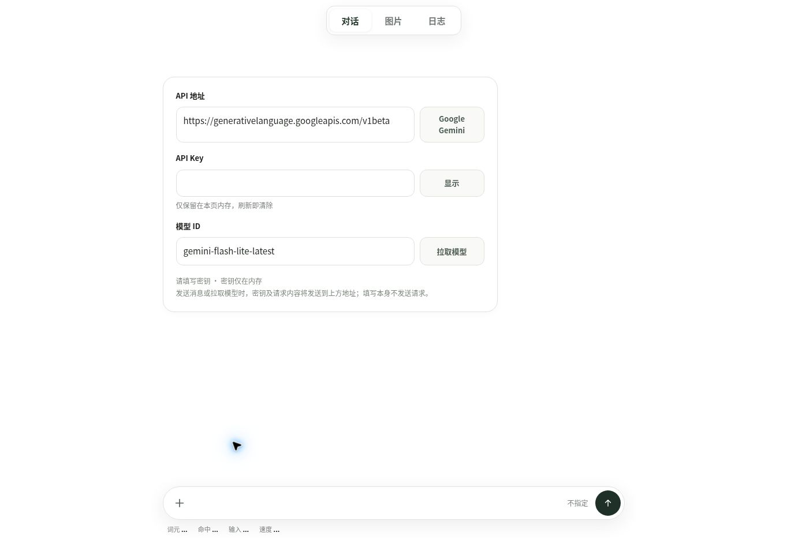

# v0.3.0 发布后记录

观察时间：2026-10-30T05:01:35Z（北京时间 13:01:35）。本记录只补充发布事实，不改变图内源提交或把浏览器冒烟检查升级为完整场景验收。

| 身份或检查 | 观察 |
| --- | --- |
| 项目源提交 | `d0b794896092c2b68fb40e0be33697a7d8a528e4` |
| 知识覆盖层候选 | `878e508ad0d7a1e1a222b581f1c115df8506898f`；远端 86 个项目变更与 8 个知识文件的 blob 身份均与提交内容匹配 |
| 合并 | [PR #6](https://github.com/zjj1280637679-ship-it/simple-llm-api-web/pull/6)；合并提交 `f6fb0f70f2c283b39d020042e9e8a377506761ab` |
| PR CI | [41005740437](https://github.com/zjj1280637679-ship-it/simple-llm-api-web/actions/runs/41005740437)，success |
| main 构建及 Pages 发布 | [41005930208](https://github.com/zjj1280637679-ship-it/simple-llm-api-web/actions/runs/41005930208)，success，2026-10-30T05:00:22Z 完成 |
| 生产入口 | [极简 LLM](https://zjj1280637679-ship-it.github.io/simple-llm-api-web/)；页面 script src 为 `./src/app.js?v=59e33c633ef519d9607f`，与本地构建一致 |
| 浏览器 | 1363×936 云端 Chrome；页面启动、对话/图片/日志切换、图片尺寸面板及 API 设置打开成功 |
| 布局观察 | API 设置视图的 documentElement clientWidth 与 scrollWidth 均为 1363；不代表全部视口与全部内容组合 |
| 工具接口 | 7 个会话工具已注册；导航调用返回 image 工作区；send 描述已说明流程、协议、交付与未知目标的区分，未调用 send |
| 请求与数据范围 | 两个工作区未配置密钥，消息与网络日志均为 0；未填写密钥、未发送真实模型请求、未做付费或物理 iOS 验收 |

本地 392 项回归中 391 通过、1 项原有可选 MCP SDK 测试跳过；21 个最简宿主及 680/820 个有限模型组合检查通过。完整命令输出与输入身份见 [VALIDATION.md](../../../VALIDATION.md) 和 [review.json](../../../development/evidence/review.json)。知识检查对 213 个项目文件为 MATCH。

控制台抽样返回的 8 条 error 均来自浏览器扩展的 metadata 发送；没有据此宣称“控制台零错误”。本次 UI 观察只覆盖上述操作，不证明外部服务可用性、所有异步路径、持久化效果或用户目标达成。

截图与本记录属于 `knowledge/**` 发布覆盖层，不进入生产构建，也不进入冻结项目文件指纹；旧快照保留。后续仅补充覆盖层的提交可具有相同生产构建指纹，不能误称为新的开发阶段或新的场景验收。
