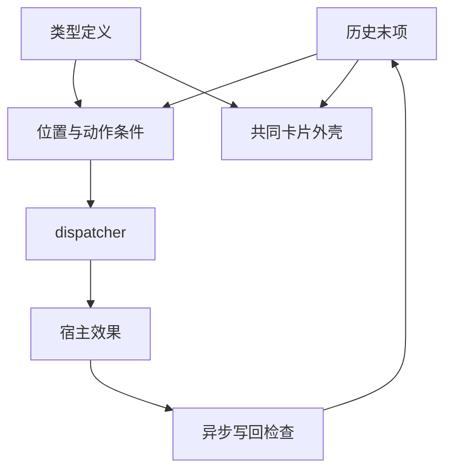

# v0.4.0 交互卡知识快照

知识版本 **1.2.0**；2026-10-30T13:38:00+08:00。源提交 `6a2e6c012766936653b312181181a667ec1f16bb`，树 `4f8238dab28cee2f50f983415a0af41499b8e99c`。覆盖 235 个项目文件、26 个模块及宿主，364 节点、963 条来源关系。发布观察和截图属于另外的覆盖层。

## 快速理解

这是原生 ES modules 的静态 BYOK AI 工作台，目标是极简视觉与使用体验。首次使用读 [首页](../../../README.md)，开发者读 [文档导航](../../../docs/README.md)，Agent 先运行 `node knowledge/check.mjs`，再按课题查询。

v0.4.0 以交互卡承载 API 设置、模型设置、用量图表、日志快照和调用确认。活跃性只有一条关系：**历史最后一项就是这张卡**。不保存 active/pending/expired；字段编辑、按钮和卡片菜单动作统一进入 dispatcher 和类型注册表。任何后续历史项都冻结旧卡。

位置活跃不等于动作条件成立：忙碌时的配置修改可暂停；确认卡可以回应当前等待的调用。Promise 资源只在内存，追加其他历史、取消或销毁时释放；刷新不恢复调用。图表与日志都是快照，旧卡不随外部状态改变。

## 当前边界

- 五类卡片已走共同机制；备份面板和普通文本/图片结果仍有独立展示器，尚未全站卡片化。
- AI 输出文字不会自动获得可执行卡片权限；未来结构化卡片输入需要显式类型映射和宿主动作能力。
- schema 2 可读取 schema 1 的设置卡；未知卡类型/版本保留为转义数据，不猜测动作。API Key、目标确认和 Promise 不入存档。
- 自动日志仍仅内存；用户主动插入日志卡时副本随历史保存，卡内明确说明。
- 三个 CLI 已移入 `cli/`，旧根路径需更新。README 缩为 44 行；许可为用户选择的 MIT。

[开发态模型](../../../design/DEVELOPMENT_MODEL.md)保留需求/条件、八类维度及独立奖励惩罚；[认识论设计](../../../design/EPISTEMIC_DESIGN.md)继续分离观察、解释、策略、效果与目标。运行态 42 文件构建可追溯，但不是阶段等效证明；阶段仍由需求/条件方向稳定判断。

## 按课题读

| 路由 | 入口 |
| --- | --- |
| cards | [交互卡协议](../../../docs/INTERACTION_CARDS.md)、[本轮记录](../../../docs/reviews/2026-10-30-cards.md) |
| judgments | [认识论设计](../../../design/EPISTEMIC_DESIGN.md)、[有限模型](../../../development/models/README.md) |
| ownership | [状态归属](../../../docs/WORKBENCH_MODULES.md)、[模块目录](../../../module-library/README.md) |
| storage | [保存与迁移](../../../docs/LOCAL_PERSISTENCE.md) |
| validation | [验证入口](../../../VALIDATION.md)、[发布观察](deployment.md) |

其余已有 model/transport/conversation/reasoning/image/attachments/metrics/layout/catalog 路由继续可用。`node knowledge/query.mjs route cards` 给出源码与反例测试，`impact src/card-types.js` 提供字面导入反向导航；动态注入和事件还需人工检查。

## 模块身份

| ID | 源码 | 模块版本 | 宿主版本 |
| --- | --- | --- | --- |
| R-007 | [src/canvas-geometry.js](../../../src/canvas-geometry.js) | 0.1.1 | 0.1.1 |
| R-011 | [src/clipboard-report.js](../../../src/clipboard-report.js) | 0.1.1 | 0.1.1 |
| F-008 | [src/error-diagnostic.js](../../../src/error-diagnostic.js) | 0.1.1 | 0.1.1 |
| F-007 | [src/image-delivery.js](../../../src/image-delivery.js) | 0.1.1 | 0.1.1 |
| R-006 | [src/lifecycle.js](../../../src/lifecycle.js) | 0.1.1 | 0.1.1 |
| F-006 | [src/native-json.js](../../../src/native-json.js) | 0.1.1 | 0.1.3 |
| R-005 | [src/provider-identity.js](../../../src/provider-identity.js) | 0.1.1 | 0.1.2 |
| R-009 | [src/request-lifecycle.js](../../../src/request-lifecycle.js) | 0.1.1 | 0.1.1 |
| R-012 | [src/stream-painter.js](../../../src/stream-painter.js) | 0.1.1 | 0.1.1 |
| R-013 | [src/transport-evidence.js](../../../src/transport-evidence.js) | 0.1.1 | 0.1.1 |
| F-009 | [src/view-markup.js](../../../src/view-markup.js) | 0.1.1 | 0.1.1 |
| R-008 | [src/view-position.js](../../../src/view-position.js) | 0.1.1 | 0.1.1 |
| C-002 | [src/workbench.js](../../../src/workbench.js) | 0.3.0 | 0.1.2 |
| R-010 | [src/workspace-storage.js](../../../src/workspace-storage.js) | 0.1.1 | 0.1.2 |
| F-010 | [src/completion-evidence.js](../../../src/completion-evidence.js) | 0.1.0 | 0.1.0 |
| R-014 | [src/completion-policy.js](../../../src/completion-policy.js) | 0.1.0 | 0.1.0 |
| F-011 | [src/image-evidence.js](../../../src/image-evidence.js) | 0.1.0 | 0.1.0 |
| F-012 | [src/request-outcome.js](../../../src/request-outcome.js) | 0.1.0 | 0.1.0 |
| F-013 | [src/api-target.js](../../../src/api-target.js) | 0.1.0 | 0.1.0 |
| R-015 | [src/request-transport.js](../../../src/request-transport.js) | 0.1.0 | 0.1.0 |
| F-014 | [src/app-error.js](../../../src/app-error.js) | 0.1.0 | 0.1.0 |
| R-016 | [src/interaction-cards.js](../../../src/interaction-cards.js) | 0.1.0 | 0.1.0 |
| F-015 | [src/card-types.js](../../../src/card-types.js) | 0.1.0 | 0.1.0 |
| F-016 | [src/card-markup.js](../../../src/card-markup.js) | 0.1.0 | 0.1.0 |
| R-017 | [src/card-confirmations.js](../../../src/card-confirmations.js) | 0.1.0 | 0.1.0 |
| C-003 | [src/workbench-cards.js](../../../src/workbench-cards.js) | 0.1.0 | 0.1.0 |

模块和宿主各自的时间戳、课题、状态范围、反例、扩展点和证明义务在对应契约中。26 个本地宿主不是全仓原子化或完整证明声明。

## 验证与来源

[review.json](../../../development/evidence/review.json)：409 项回归，408 通过、1 项原有可选 MCP SDK 跳过；26 宿主通过；174 个输入指纹。有限模型包括结束判断 680 组合、图片效果 820 组合、卡片位置 1,555 条历史 / 7,465 查询。外部模型、付费调用与物理 iOS 未在本轮验收。

完整 F/C/H/Q、无界状态的抽象对应、真实条件、成功替代路线及阶段投影仍保留待证义务。图中的 evidence:browser 是明确标记的历史 v0.2.0 观察；本轮线上事实只看 [deployment.md](deployment.md)。

[旧 v0.3.0 快照](../v0.3.0-d0b794896092/README.md)保留当时路径与结论；不把旧记录改成新证据。`check` 对本地文件身份负责，不核实远端 HEAD 或自动鉴定证据真伪。
