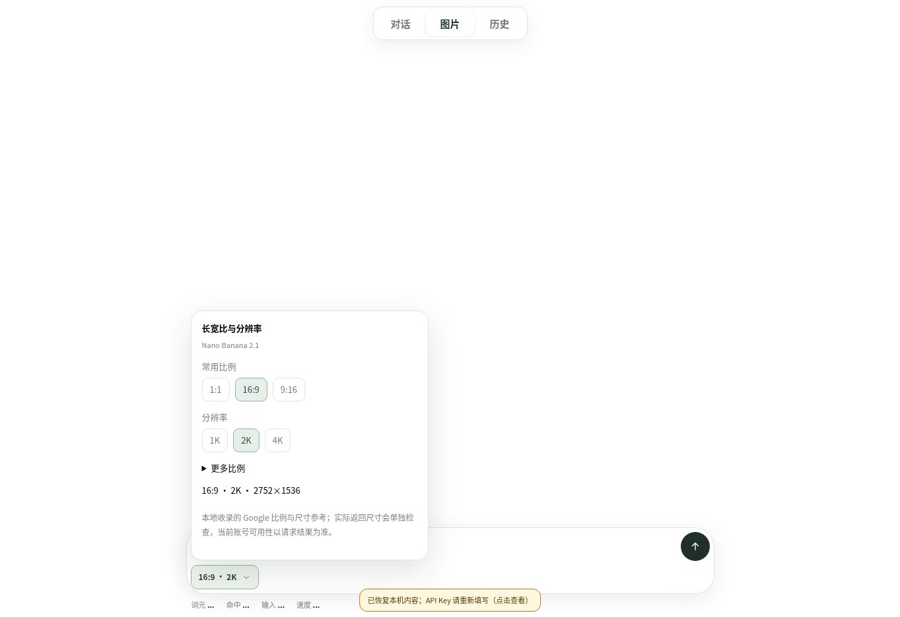

# 0.5.1 线上交互验收

观察时间：2026-11-04 16:00–16:04（北京时间）。生产地址：https://zjj1280637679-ship-it.github.io/simple-llm-api-web/ 。云端桌面 Chrome，1363×936；本轮为界面与本机保存验收，无真实 API Key、供应商请求或图片生成费用。

项目源提交 `0b9e37929c75d04a5876124b59eaace0042d97d0`；首个发布提交 `553b70ee8855d5e07d9bc93c1d193013a54486f3`。GitHub Actions [41796058068](https://github.com/zjj1280637679-ship-it/simple-llm-api-web/actions/runs/41796058068) build/deploy 均 success。线上实际 script URL 的构建身份为 `ef50f123d6661be0713b`，与本地白名单构建相同。旧版身份 `67890a3c225df77a901f` 已被替换。

| 操作 / 条件 | 实际观察 |
| --- | --- |
| 历史页逐字键入 abcd | 得到 abcd，焦点保留，选择区间 [4,4] |
| 左移两位再输入 X | 得到 abXcd，焦点保留，选择区间 [3,3] |
| Backspace、Shift+Left、Z | 得到 aZcd，焦点保留，选择区间 [2,2] |
| 清空后逐字写入“检查A” | 顺序正确，列表只保留匹配会话；这里是字符输入，不声称真实输入法组合验收 |
| 恢复 0.5.0 已保存模型旧卡 | 直接显示静态参数、模态与模板；缺失协议显示“历史协议未记录”，不按当前 Anthropic 推断 |
| 新模型卡保存输出预算 1234、温度 0；返回设置冻结 | 摘要保留 1234 和 0；Anthropic 解释来自当时协议 |
| 当前协议 Anthropic → Gemini | 冻结模型卡 innerHTML 与变更前完全相同 |
| 刷新 | 冻结模型卡 innerHTML 仍相同；其中 input/select/button/details 共 0；整卡 opacity=1 |
| 打开图片参数 | 首层 3 个常用比例、3 个分辨率；其余 11 个比例在“更多比例”展开 |
| 16:9 → 4K → 展开 1:8 → 2K | 分别显示 16:9·4K 和 1:8·2K；改变一维保留另一维；更多比例仍展开且选中 1:8 |
| 键盘 Enter 选择 16:9，再收起更多比例 | 当前值为 16:9·2K·2752×1536；截图如下 |

此次捕获的近期错误记录来自浏览器扩展元数据通信，不将其归为网页异常；未把日志检查扩大为所有错误不存在的证明。未验收真实 IME、移动设备、Safari、全部图片模型或真实供应商能力。有限模型、合成 DOM、实际点击与部署成功保持各自证据范围。

本记录与截图属于 knowledge 发布附加项，不改变被快照记录的项目文件；不会把旧验证日期改写为今天，也不升级完整 F/C/H/Q。
