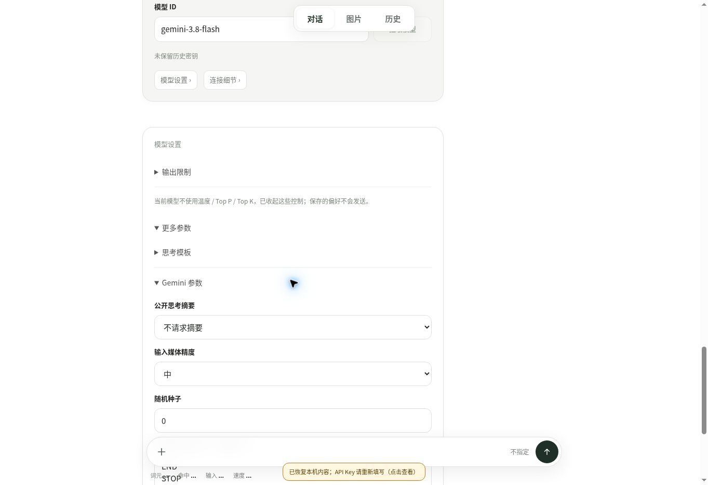

# Gemini 0.6.2 线上验收

2026-11-04（北京时间），桌面 Chrome。线上地址：https://zjj1280637679-ship-it.github.io/simple-llm-api-web/ 。部署提交 `ae04edd61deb01079ef524c4ba04d27ba50e736b`；生产模块标识 `848e0c11bd74f013ae00` 与本地构建一致。GitHub Pages 工作流 41804141011 已成功。

| 场景 | 实际观察 |
| --- | --- |
| 官方端点选择 gemini-3.8-flash | 温度、Top P、Top K 控件收起；显示偏好保留但不发送的说明 |
| 打开底部思考菜单 | 不指定 / low / medium / high；不显示 minimal |
| 专属参数交互 | 媒体精度改为中；停止序列填写 END 与 STOP 两行；不请求摘要和种子 0 保留 |
| 切换为未登记的 gemini-future | 采样控制恢复；未知格式可展开；可以选择预算格式 |
| 选择未知模型的预算格式 | 底部强度复位为不指定；菜单出现动态和 Token 预算输入，不自行选择强度 |
| 刷新 | 专属参数与预算格式恢复；历史 3.8 卡仍显示原模型、low 和原采样说明 |
| 改为 gemini-2.5-pro | 温度偏好 0 恢复可编辑；预算输入 min=128、max=32768，无关闭档位 |
| 返回 gemini-3.8-flash | 再次收起采样控件，保留专属参数，截图见下 |

本次没有填写真实密钥，也没有发起供应商模型列表或生成请求。thinking=true 但格式未知、负能力回执及显式工作区交接由合成宿主验证，未冒充线上上游回执。手机、Safari、真实账号权限/配额、计费和生成效果仍未验收。

截图与本记录是知识发布附加项，不修改项目源快照；本地回归 445 通过、1 跳过，35 宿主和 5 个有限模型的原始证据分别保存。
